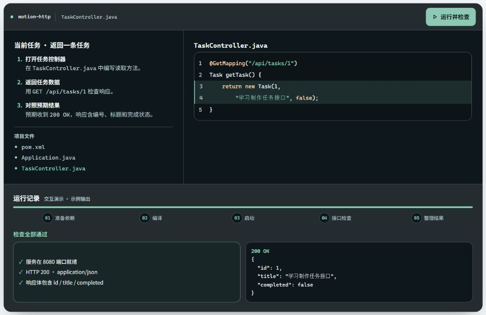

# 码起步（Maqibu）

码起步是面向学过 Java 基础的学习者的后端项目实战平台。每章接着上一章的工程继续开发，从 HTTP 和 JSON 起步，再练习 MySQL、Spring Boot 和业务功能，最后独立完成一个可运行、能讲清的后端作品。

例如在 HTTP 项目中，你会用 JDK 的 HttpServer 实现任务查询接口，再请求 `GET /api/tasks/1`，核对状态码和 JSON 字段。官网的公开沙盒可以先体验接口响应如何改变网页状态。学习工作台采用邀请码注册。

[访问码起步官网](https://try.maqibu.online/)



## 快速开始

以下命令在 Windows PowerShell 中从仓库根目录运行。准备 Node.js 24、JDK 21 和 Maven 3.9。SQL 教学环境与隔离检查还需要 Docker Desktop。

```powershell
npm --prefix ./new-system/frontend ci --cache ./.cache/npm
```

在后端终端中设置实际安装目录并启动服务。使用 SQL 或隔离检查时，可在同一个终端设置 `$env:CS_DOCKER_BIN = (Get-Command docker.exe).Source`。

```powershell
$env:CS_JAVA_HOME = 'C:/path/to/jdk-21'
$env:CS_MAVEN_HOME = 'C:/path/to/apache-maven-3.9'
./scripts/project.ps1 backend-dev
```

另开一个终端启动前端。

```powershell
./scripts/project.ps1 frontend-dev
```

打开[学习首页](http://127.0.0.1:5178)，从「开始第1节」进入课程。[后端健康接口](http://127.0.0.1:5188/api/v1/health)可用于确认服务已启动。学习者工程应建在本仓库之外。平台 SQLite 数据、日志和本地缓存位于 `new-system/runtime/`。

## 工程目录

```text
CodeSomething/
├── docs/                    产品规格、架构、课程契约与实施追踪
├── scripts/project.ps1      仓库级开发、构建和测试入口
└── new-system/
    ├── frontend/            React、TypeScript、Vite
    ├── backend/             Java 21、Spring Boot、SQLite
    ├── idea-plugin/         IntelliJ IDEA 插件
    ├── course-packs/        版本化课程、骨架与参考实现
    ├── curriculum/         课程依赖和发布锁
    ├── runner/             代码检查环境
    ├── tooling/            开发工具、阶段校验与工具测试
    └── docs/acceptance/    阶段验收摘要与发布校验样本
```

## 构建与测试

```powershell
./scripts/project.ps1 frontend-build
./scripts/project.ps1 backend-test
```

完整前端测试 `./scripts/project.ps1 frontend-test` 会核对个人导入的 Tlias 资料文件及其校验和。使用该测试前，请按[本机资料导入说明](docs/27-本机资料与Tlias实战课程.md)准备资料。课程可使用源码内的教学正文和起步工程，原始资料阅读入口依赖本机导入。

阶段发布门禁使用独立环境和固定证据。运行前请阅读[工程维护约定](docs/15-工程目录与维护约定.md)和[验收索引](new-system/docs/acceptance/README.md)。

## 文档

- [文档导航](docs/README.md) · [产品定位](PRODUCT.md) · [设计基线](DESIGN.md)
- [前端](new-system/frontend/README.md) · [后端](new-system/backend/README.md) · [IDEA 插件](new-system/idea-plugin/README.md)
- [后端 API](new-system/backend/API.md) · [本地运行与隔离检查](new-system/runner/README.md) · [实施追踪](docs/实施追踪.md)
