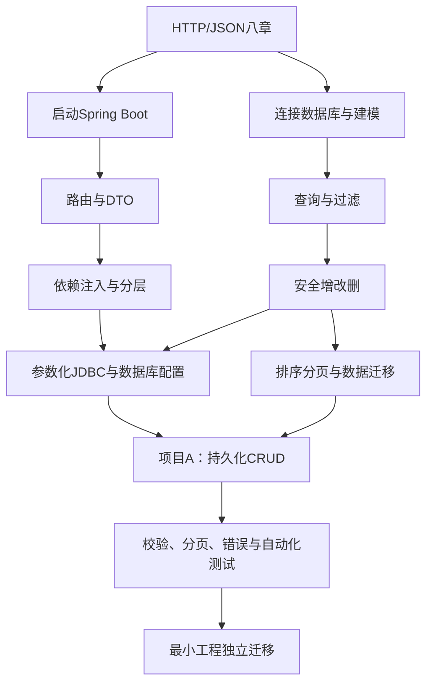

# R3.1 知识依赖与项目A关卡

2026年11月16日覆盖性更新：HTTP、SQL、Boot及项目A都必须围绕各自同一工程递进；A从最小POM与Application开始亲手实现任务管理，后续关卡承接源码。原版逐关骨架与双结果要求为历史发布事实；网页主线与后续课程遵循[项目教学原则](25-同一工程从零完成的项目教学原则.md)。

日期：2026年11月12日。R3.1设计与静态核验完成；随后SQL已由[docs/11的R3.2](11-R3.2SQL教学闭环与运行契约.md)落地，Spring Boot和项目A课程接R3.3。以下保留R3.1设计基线；实际SQL契约以docs/11为准。上位约束：PRODUCT.md、docs/01、docs/05、docs/07、docs/08。机器可读图见[new-system/curriculum/r3-plan.json](../new-system/curriculum/r3-plan.json)，状态为draft，保留最初规划，不直接进入课程接口或用户学习记录。

## 学习路径与时间

从已发布的“后端入门实验室”继续，先把任务保存在数据库里，再用Spring Boot替换手写HTTP服务，最后完成个人任务管理接口。每天约一小时；单次安排约15分钟讲解与预测、30分钟IDE或SQL实践、15分钟验证与回看。表中的时长是内容规划估算，允许拆开续学。

SQL基础项目暂名“任务数据实验室”，Spring Boot基础项目暂名“接口启动实验室”。两者都提供项目目标、预期产物、章节目录、概念、可运行示例、修改任务及迁移题。已有Java基础按需回顾，遇到record、泛型、注解或异常时就近补讲。

## 已发布八章核对

核对文件：course-packs/http-json-basics/1.1.0/project.json、CourseController、DockerCheckRunner、UnderstandingRules、LearningSessionController。课程包与后端当前均固定八个stageId；不能仅添加JSON就宣称新课程可用。

| stageId | 已有目标与模式 | 已有检查及后续用途 |
| --- | --- | --- |
| workspace | 开发准备，阅读 | IDEA/JDK/运行进程；作为后续环境操作起点 |
| request | 方法、地址、端口、路径，阅读 | 当前只教GET；POST/PUT/DELETE及请求体需补课 |
| response | 状态、响应头、响应体，阅读 | 200/404与JSON响应；后续补201/204/400 |
| json | 字段与类型，阅读 | 字符串、数字、布尔；后续补数组及对象映射 |
| run-server | 启停服务，代码 | server-smoke-v1：编译、启动并收到两个HTTP响应；正式理解题验证重启/端口，不能据此断言业务正确 |
| trace | 请求到分支，阅读 | 路径、status、body；衔接Controller到Repository的数据流 |
| fix-response | 修复任务响应，代码 | task-json-v1：任务1的状态/类型/字段与任务2的404；正式理解验证状态与布尔类型 |
| transfer | 笔记资源迁移，代码 | notes-json-v1：新路径、字段及未找到；正式理解验证路由/数据映射 |

五个阅读章保存位置；三个代码章使用绑定版本、策略、摘要的功能和理解双结果。阅读、随堂题、预览和步骤勾选不产生正式完成。当前正式题为确定性情境选择；作品讲解和独立程度仍需后续任务验证。

发现一项发布内容漂移：fix-response概念说明仍写“隔离运行器仍待接入”。记录为下一课程修订版的修正项；本次保留1.1.0和历史快照原样。数据库、写入请求、Spring配置、依赖注入、DTO、校验、分页、测试均是待补内容。

## 最小知识依赖

图中箭头表示教学先修，全部课程可预览。已实现的HTTP代码先修沿用R2.4；新跨课程关系是教学设计提案，发布前由服务端完成契约落地，不新增自报阅读门禁。

精确节点及边以r3-plan.json为准。节点标注目标、产物、检查、变式、预计分钟；现有HTTP节点引用发布包。新增节点均为规划，graph检查通过只证明结构一致。

## SQL基础项目：R3.2

| 节点 | 目标和产物 | 功能检查 / 理解变式 | 分钟 |
| --- | --- | --- | --- |
| db-connect | 连接专用MySQL、识别实例/数据库/表，保存连接自检结果 | SELECT 1及目标库核对 / 区分拒绝连接、认证错误和表不存在 | 30 |
| db-model | 将任务映射为id、title、completed，提交建表SQL | 主键唯一、标题必填、字段类型与默认值 / 解释重复编号与NULL失败 | 40 |
| sql-read | SELECT指定字段、WHERE筛选，提交查询SQL | 多组固定数据比较结果集 / 改条件预测空集和多行 | 40 |
| sql-write | INSERT、带WHERE的UPDATE/DELETE，提交写入SQL | 前后数据及受影响行数 / 预测缺失WHERE、修改不存在编号 | 50 |
| sql-page | 稳定排序与LIMIT/OFFSET，提交分页SQL | 包含相同completed值的数据、相邻页与空页 / 解释为何用唯一id稳定排序 | 35 |
| sql-transfer | 从任务迁移到书签数据，独立建表与CRUD | 新字段/新数据上的结果 / 解释内存数据与持久数据、重置影响 | 45 |

预计240分钟，可分约4—6次学习；不设按天强制解锁。BOOL在MySQL中的存储和映射细节在R3.2实测后讲解，不能把数据库值与JSON布尔类型视为相同表示。

工程提案：教学数据库采用MySQL8.4系列，平台仍使用SQLite；R3.2先探测Docker与镜像，锁定可用镜像摘要、字符集、连接器、依赖和初始化脚本。此版本选择未完成本机验证，不宣称环境可用。优先使用docker exec调用固定客户端，GUI工具作为可选入口。

数据库环境与重置要求：

1. 学习库、SQL交互尝试库、功能验收库各自隔离。只绑定本机端口，账号只操作专用教学库；配置凭据不写入提交、日志或AI上下文。无需公网数据库或付费服务。
2. 每次确定性检查从版本化建表和种子数据创建独立实例或独立schema；读题数据含已完成/未完成、中文标题、同排序值、多页和空集情境。报告绑定SQL字节摘要、种子摘要、数据库镜像摘要与规则版本。
3. 交互SQL也经过隔离执行器，限制时间、行数、输出和语句范围。初始化/重置由平台受控脚本执行，学员SQL不连接平台SQLite或其他学习者数据。
4. 重置界面明确展示目标与将清空的数据；用户点击确认后只重置教学练习库。验收库可自动重建。未识别的库或外部连接拒绝重置；取消或失败时保留可恢复状态并给重试入口。
5. MySQL DDL可能隐式提交，初始化和重置用受控重建方案；SQL写入练习的事务策略在R3.2实测，不能用一次ROLLBACK保证所有语句恢复。断线/镜像缺失/认证错误归为环境失败，不计知识错误。

R3.2交付顺序：环境/重置正反例 → 最小db-connect与sql-read可运行纵向流程 → 其余SQL章与迁移题 → 双结果及续学 → 浏览器验收。第一条验收链：错误WHERE → 报告展示实际与预期 → 修正SQL → 功能通过 → 新数据情境理解通过 → 重启恢复。另验重置取消、非目标库拒绝、超时、并发库隔离与原学习数据未变。

## Spring Boot基础项目

在R3.3前半段实现，先使用固定最小骨架，再解释项目结构与依赖来源。保留Java21；Boot及JDBC依赖在课程构建时锁定验证，平台当前pom中的版本仅作本机工程事实，不能直接当作学员课程已验证版本。

| 节点 | 产物 | 功能检查 / 理解变式 | 分钟 |
| --- | --- | --- | --- |
| boot-start | 可启动的最小Maven项目与健康查询 | 干净目录构建、HTTP响应 / 端口冲突与依赖下载失败归类 | 45 |
| boot-http | 路径/查询参数、请求体和DTO的GET/POST示例 | 反序列化、JSON对象/数组、状态 / 字符串布尔与缺字段情境 | 50 |
| boot-layers | Controller→Service→Repository构造器注入 | 路由调用真实组件 / 解释为什么new对象不等于容器注入 | 40 |
| boot-jdbc | DataSource配置与参数化查询 | 数据库读取、引号标题、重启持久 / 区分绑定值与拼SQL、数据源与平台库 | 55 |

MyBatis/JPA、复杂事务、多表关联、登录权限留在后续内容；项目A先用JdbcTemplate把SQL与Java建立清晰对应。Spring官方REST指南支持控制器与JSON教学；关系数据指南支持JdbcTemplate组织方式，其演示数据库并非本项目MySQL环境，课程仍需单独构建验证。

## 项目A进入条件与逐关产物

项目A固定题材为个人任务管理，产物是本机可运行后端、建表/示例数据、API请求清单、自动化测试和数据流讲解。查看课程始终可用。建议正式开始前具备HTTP三个代码章的有效完成证据、SQL迁移任务与boot-jdbc双结果；环境准备通过单列。尚未发布的基础单元显示待发布，不以本次规划生成学习通过记录。新跨课程正式解锁规则随实现一起验证，不能仅凭前端判断增加阻断。

| 关卡 | 交付行为与API约定 | 功能反例 / 理解迁移 | 骨架与分钟 |
| --- | --- | --- | --- |
| a-read | GET /api/tasks和/{id}读取MySQL，200或404 | 空列表、未知id、重启后数据 / 沿请求讲到SQL和响应 | 完整分层结构，补读取，50 |
| a-create | POST /api/tasks，返回201和新资源；id由库生成 | 连续创建、引号标题、响应类型、库中记录 / 解释SQL参数绑定 | 给DTO与方法签名，50 |
| a-update-delete | PUT /{id}更新title/completed，200；DELETE /{id}成功204，未知id为404 | 更新未知id、重复删除、其他记录不变 / affected rows与404的关系 | 给接口契约，不给业务方法体，55 |
| a-validation | title去首尾空白后1—100字符，completed必传布尔；400/404统一错误JSON | 空白/超长/缺字段/非法JSON，写入前后核对 / 解释为什么无效请求不能落库 | 只给错误结构与断言，55 |
| a-pagination | GET /api/tasks?page=0&size=10，可选completed筛选，id升序；返回items/page/size/total | size为1—50，page非负，非法参数400，末页/空页/稳定排序 / 解释筛选与总数一致性 | 提供需求与固定数据，55 |
| a-transfer | 最小工程独立实现书签CRUD、校验、分页与测试，附运行/讲解 | 新字段和未见数据集，重启持久；测试能检出至少一个故意错误 / 请求→DTO→Service→SQL→响应 | 仅构建配置、数据连接示例与契约，拆两次90 |

预计355分钟；加SQL和Boot基础合计785分钟，约14个一小时学习时段的内容量，遇到排错可延长。无自动降低每日目标或强制赶进度。接口约定是工程提案，作为关卡检查基线；发布前集中到版本化课程包，不能散落前后端各维护一份。

每关都要求对参考实现跑正例，对至少一个行为错误变式跑失败例。A最后的独立迁移在干净工程运行；复制/示例帮助记录与完成证据并存，独立程度由实际帮助和迁移表现支持。自动选择题通过不能代替开放讲解证据。

## 后端契约接续与发布门禁

当前CourseController、UnderstandingRules、LearningSessionController、CheckJobController/Worker及DockerCheckRunner均含HTTP课程或文件范围假设。R3.2实现时逐步抽取版本化课程注册、策略路由、文件清单与跨课程续学解析，先保持旧HTTP接口行为。SQL策略不得落入现有HTTP默认策略；不支持的课程/策略明确拒绝。

R3新报告和理解尝试继续绑定课程/版本/关卡/快照摘要/规则版本，并增加环境和种子摘要。完成由服务端核对有效结果、先修、幂等及并发事务后写入；失败重试与新版本不覆盖历史证据。阅读保存位置、预览不推进正式位置。扩展前用既有HTTP行为测试作为回归依据。

发布要求：依赖无环且引用完整；包内每章目标/示例/步骤/预期/常见错误/随堂题齐全；正式关卡有参考正例、失败变式和独立理解题；隔离构建与重置通过；历史版本可读取；新课程API/快照/判题/双结果/续学完成端到端验证。规划图本身不满足发布条件。

## 来源与本轮核验

2026年11月12日通过HTTPS实际读取[Spring REST指南](https://spring.io/guides/gs/rest-service/)和[Spring JDBC指南](https://spring.io/guides/gs/relational-data-access/)，采用控制器到JSON、JdbcTemplate参数化访问的教学方向。MySQL8.4建表与事务页面访问返回403，未作为本轮已核实依据；R3.2须结合可访问官方文档及真实MySQL验证类型映射、DDL提交、重置和连接器兼容性。

执行`node new-system/tooling/checks/check-r31-plan.mjs`核对图、HTTP映射、结构与文档链接，实际输出见[new-system/docs/acceptance/R3.1/README.md](../new-system/docs/acceptance/R3.1/README.md)。本轮是课程设计与静态核验，应用构建、MySQL执行、网页验收在后续实现阶段进行。
