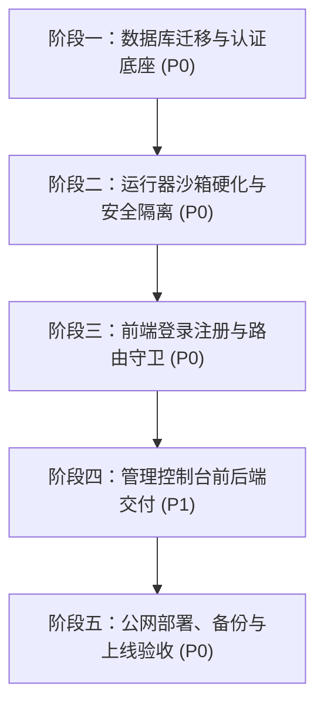

# 37 公网上线登录权限与管理控制台实施计划

本文档为 码起步平台从「本机单用户练习」向「公网多用户服务」升级的架构改造与实施契约。核心目标是建立健壮的用户认证与鉴权机制、实现多租户数据隔离、加固公网代码执行沙箱安全底线，并交付功能完备的管理员控制台（Admin Console）。

---

## 1. 背景与改造边界

### 1.1 现状与挑战
当前系统（前端 0.25.0、后端 0.2.0、SQLite V16）基于「本机单用户优先」原则构建：
- 所有学习会话、草稿、提交快照、检查作业及个人偏好均未绑定用户身份（隐式单租户）。
- 评测运行器包含 `LocalProjectRunner`，会直接在宿主机上启动 Maven/JDK 编译运行学员代码；在公网环境下，这属于极度危险的远程代码执行（RCE）漏洞。
- 缺少针对公网多用户的用户管理、权限鉴权、评测作业监盘与服务治理后台。

### 1.2 改造目标
1. **身份认证与权限控制（Auth & RBAC）**：建立基于 JWT + Refresh Token 的安全登录体系，划分普通学员（`ROLE_STUDENT`）与管理员（`ROLE_ADMIN`）。
2. **多租户数据隔离（Multi-tenancy）**：平滑升级数据库至 V17，存量历史数据安全挂载至初始管理员，后续所有数据操作严格按 `user_id` 物理/逻辑隔离。
3. **公网运行沙箱安全红线（Critical Security）**：公网环境全面收敛代码执行通道，严格禁用宿主机直接执行，强制使用只读且禁外网的 Docker 沙箱容器。
4. **管理控制台（Admin Console）**：在前端 `/admin` 落地可视化管理后台，提供学员档案、学习进度、作业监盘、题库管理、运行器健康与审计日志。

---

## 2. 核心架构与技术方案

### 2.1 认证与令牌机制
- **令牌选型**：无状态 JWT（Access Token）+ 数据库持久化 Refresh Token（支持主动吊销与黑名单）。
  - **Access Token**：有效期 2 小时，Header 携带 `Authorization: Bearer <token>`。Payload 包含：`userId`, `username`, `role`, `exp`。
  - **Refresh Token**：有效期 14 天，通过 `HttpOnly; Secure; SameSite=Lax` Cookie 传输或前端受保护存储；支持设备切换与主动下线。
  - **密码算法**：采用标准 `BCrypt`（迭代因子 12），严格拒绝明文或不可逆哈希前不加盐。
- **角色模型（RBAC）**：
  - `ROLE_STUDENT`（学员）：学习大厅、课程工作台、课内实战、个人中心、复习与生成项目。
  - `ROLE_ADMIN`（管理员）：具备学员全部权限，专享 `/admin` 控制台及全部 `/api/v1/admin/*` 接口调用权。

### 2.2 数据库多租户演化（Flyway V17）
新建迁移脚本 `new-system/backend/src/main/resources/db/migration/V17__auth_and_multitenancy.sql`：
1. **新建认证与审计表**：
   - `users`：`id TEXT PRIMARY KEY`, `username TEXT UNIQUE`, `email TEXT UNIQUE`, `password_hash TEXT`, `role TEXT`, `status TEXT`, `created_at TEXT`, `updated_at TEXT`。
   - `user_tokens`：`id TEXT PRIMARY KEY`, `user_id TEXT`, `refresh_token_hash TEXT`, `expires_at TEXT`, `revoked INTEGER DEFAULT 0`。
   - `admin_audit_logs`：`id TEXT PRIMARY KEY`, `admin_id TEXT`, `action TEXT`, `target_type TEXT`, `target_id TEXT`, `details TEXT`, `ip TEXT`, `created_at TEXT`。
   - `invitation_codes`（可选开启）：`code TEXT PRIMARY KEY`, `created_by TEXT`, `max_uses INTEGER`, `used_count INTEGER`, `status TEXT`, `expires_at TEXT`。
2. **存量数据平滑迁移方案**：
   - 插入系统初始种子管理员：`admin`（密码由环境变量 `CS_INITIAL_ADMIN_PASSWORD` 生成，默认强密码哈希）。
   - 为现有表追加 `user_id TEXT` 字段，并更新已有行 `SET user_id = 'admin'`：
     - `learner_preferences`
     - `learning_sessions`
     - `workspace_bindings`
     - `submissions`
     - `check_jobs`
     - `stage_completions`
     - `tutor_requests`
     - `school_lab_drafts`
     - `portfolio_*`

### 2.3 公网安全边界与沙箱硬化（关键安全防线）
1. **禁用宿主机执行（Local Runner Lockdown）**：
   - 增加运行模式环境变量：`CS_RUNNER_MODE=docker_only`（公网默认）。
   - 当模式为 `docker_only` 时，服务端彻底熔断 `LocalProjectRunner`，任何试图执行宿主机命令的请求直接拒绝并记录安全审计。
2. **Docker 沙箱隔离规则**：
   - **完全切断网络**：`--network none`，阻止学员代码发起反弹 Shell、内网探测或矿机外联。
   - **资源硬限制**：`--memory=512m --cpus=1.0 --pids-limit=64`，防止 Fork 炸弹或内存溢出使宿主机宕机。
   - **文件系统保护**：容器根文件系统挂载为只读（`--read-only`），仅临时挂载只读的 JDK/Maven 依赖目录与有容量上限的 `tmpfs` 编译目录。
   - **进程超时熔断**：单次编译或运行设置 30 秒硬超时，超时触发 `docker kill`。
3. **接口防刷与防爆破**：
   - 全局内存滑动窗口限流器：
     - 登录接口：同一 IP 限制 5 次/分钟；密码连续错误 5 次锁定账号 15 分钟。
     - 判题接口：单用户限制 10 次/分钟，同时排队作业数限制为 2。
     - AI 辅导接口：单用户限制 15 次/小时，防止消耗官方额度。

---

## 3. 管理控制台（Admin Console）功能规格

管理控制台以独立前端页面落地，统一路由前缀 `/admin`。

```
/admin
├── /overview       # 运维看板：全站活跃人数、判题负荷、错误分布、系统健康度
├── /users          # 学员管理：账号检索、启用/冻结、角色授权、密码重置、学习档案
├── /submissions    # 评测监盘：实时判题队列、不可变代码快照回溯、错误日志分析
├── /school         # 课内实战：实验进度监视、实验报告批量归档导出、隔离库重置
├── /runners        # 容器环境：Docker 容器状态、MySQL 练习池监控、AI 适配器连通性
└── /audit          # 审计日志：管理操作追踪、高频告警、异常拦截记录
```

### 3.1 概览看板（Overview Dashboard）
- **指标摘要**：累计注册人数、今日活跃学员、累计代码提交量、判题通过率、当前队列堆积数。
- **并发与负载图表**：近 24 小时提交走势图、常见失败原因分类（编译错误 vs 接口不匹配 vs 超时）。
- **底层资源指示**：SQLite 文件占用体积、WAL 写入缓冲状态、Docker 守护进程连通性。

### 3.2 用户与权限管理（User Management）
- **用户列表与筛选**：按用户名、邮箱、角色（学员/管理员）、状态（正常/冻结）检索，分页展示。
- **学员档案穿透**：点击学员可侧滑打开其完整的学习画像（HTTP/SQL/Boot 关卡进度、课内实战完成数、雷达图覆盖）。
- **管理操作**：
  - **账号启闭**：一键冻结违规账号，实时拉黑其所有活跃 Token。
  - **重置密码**：生成临时密码并强制下次登录必须修改。
  - **角色升降**：为协助助教分配管理权限。
  - **邀请码管理**：生成限定使用次数的公网试学邀请码。

### 3.3 评测与作业监盘（Submissions Monitor）
- **实时队列管理**：列表显示排队中与正在运行的容器作业，支持管理员紧急手动中断（Kill）卡死容器。
- **提交快照审查**：查看任意学员提交的历史代码快照（只读 Monaco 预览），对比预期响应与实际标准输出，辅助排查判题争议。

### 3.4 课内实战与实验管理（School Labs）
- **报告归档导出**：批量汇总指定实验包（如数据库原理七大实验）已通关学员的实验报告，支持一键打包下载 Markdown/Word。
- **隔离库清理**：监控当前活跃的学员 MySQL 独立练习库，支持一键重置脏数据与释放无主库。

### 3.5 运行器与系统监控（System & Runners）
- **沙箱池状态**：列出当前存活的容器，支持一键清理孤儿容器（`Prune Orphan Containers`）。
- **外部适配器状态**：探测 Codex / AppServer AI 连接延迟与最近报错计数。

---

## 4. 前端架构与路由守卫

### 4.1 目录组织约定
```
new-system/frontend/src/
├── api/
│   ├── auth-api.ts          # 登录、注册、刷新 Token、退出、当前用户信息
│   └── admin-api.ts         # 管理后台全量接口封装
├── features/
│   ├── auth/
│   │   ├── AuthContext.tsx  # 全局认证状态与 Token 维护
│   │   ├── LoginPage.tsx    # 登录页（Cupcake/Synthwave 适配）
│   │   ├── RegisterPage.tsx # 注册页（支持邀请码字段）
│   │   └── RequireAuth.tsx  # 路由守卫高阶组件
│   └── admin/
│       ├── AdminLayout.tsx       # 控制台布局（侧边导航、顶栏、面包屑）
│       ├── AdminOverview.tsx     # 概览看板
│       ├── AdminUsers.tsx        # 学员与权限管理
│       ├── AdminSubmissions.tsx  # 评测与快照监盘
│       ├── AdminSchool.tsx       # 课内实战与报告归档
│       ├── AdminRunners.tsx      # 沙箱与环境监控
│       └── AdminAudit.tsx        # 审计日志
```

### 4.2 路由守卫与状态流转
- **未登录拦截**：访问主线学习与个人中心时，若未登录自动重定向至 `/login?redirect=...`。
- **权限拦截**：普通学员访问 `/admin` 时返回 403 页面或友好提示，仅 `ROLE_ADMIN` 允许渲染管理后台。
- **Token 自动续期**：Fetch 统一封装拦截器，在收到 401 响应时静默发起 `/api/v1/auth/refresh`；刷新成功自动重放原请求，刷新失败清除登录状态并跳转登录。
- **导航联动**：改造 `PersonalMenu.tsx`，未登录时展示「登录 / 注册」；已登录管理员展示「管理控制台」快捷入口。

---

## 5. 核心 API 契约设计

### 5.1 认证接口 (`/api/v1/auth`)
| 方法 | 路径 | 权限 | 请求体摘要 | 响应体摘要 |
| :--- | :--- | :--- | :--- | :--- |
| `POST` | `/api/v1/auth/register` | 公开 | `{username, password, email, inviteCode?}` | `{userId, username, role, token}` |
| `POST` | `/api/v1/auth/login` | 公开 | `{username, password}` | `{userId, username, role, token}` |
| `POST` | `/api/v1/auth/logout` | 已登录 | - | `{success: true}` |
| `POST` | `/api/v1/auth/refresh` | 公开 | Cookie 或 `{refreshToken}` | `{token, expiresIn}` |
| `GET`  | `/api/v1/auth/me` | 已登录 | - | `{userId, username, role, email}` |

### 5.2 管理接口 (`/api/v1/admin/*`)
*均需 `Authorization: Bearer <AdminToken>`。*
| 模块 | 方法 | 路径 | 功能说明 |
| :--- | :--- | :--- | :--- |
| **看板** | `GET` | `/api/v1/admin/analytics/overview` | 全站学员数、提交数、作业成功率聚合统计 |
| **看板** | `GET` | `/api/v1/admin/analytics/activity-timeline` | 近 24 小时/7 天提交与活跃趋势 |
| **用户** | `GET` | `/api/v1/admin/users?page=1&size=20&keyword=...` | 学员列表分页与搜索（含通关概要） |
| **用户** | `PATCH` | `/api/v1/admin/users/{id}/status` | `{status: "active" \| "disabled"}` 启停账号 |
| **用户** | `PATCH` | `/api/v1/admin/users/{id}/role` | `{role: "ROLE_STUDENT" \| "ROLE_ADMIN"}` 变更角色 |
| **用户** | `POST` | `/api/v1/admin/users/{id}/reset-password` | `{newPassword?}` 重置密码 |
| **评测** | `GET` | `/api/v1/admin/jobs?status=...&userId=...` | 全局跨用户作业监视 |
| **评测** | `POST` | `/api/v1/admin/jobs/{id}/kill` | 强行终止正在运行的容器作业 |
| **环境** | `GET` | `/api/v1/admin/system/health` | Docker、SQLite WAL、存储空间诊断 |
| **环境** | `POST` | `/api/v1/admin/system/prune-containers` | 回收超时和残留的沙箱容器 |

---

## 6. 分阶段实施路线图



### 阶段一：数据库迁移与认证底座（P0，预计 2~3 天）
1. 编写并测试 `V17__auth_and_multitenancy.sql`，注入初始 `admin`，完成存量单用户数据无损升级。
2. 引入 JWT 与 BCrypt 依赖，实现 Token 生成、解析与会话上下文注入。
3. 改造核心业务 Controller（`LearningController`、`SubmissionController`、`SchoolCourseController` 等），将全局硬编码单用户收敛为当前上下文的 `userId`。
4. 单元与接口测试：覆盖登录验证、Token 刷新、密码错误锁定与数据隔离隔离性。

### 阶段二：运行器沙箱硬化与安全隔离（P0，预计 2 天）
1. 增加 `CS_RUNNER_MODE=docker_only` 模式开关，彻底阻断宿主机直接运行代码。
2. 强化 `DockerCheckRunner`：强制配置 `--network none`、`--read-only`、内存/CPU/PIDs 限制与 30 秒硬超时。
3. 增加公网限流拦截器（IP 与用户双维度防爆破、防刷）。

### 阶段三：前端登录注册与路由守卫（P0，预计 1.5 天）
1. 编写 `features/auth/` 登录与注册视图，保持与现有 Cupcake / Synthwave 双主题严格一致。
2. 引入全局 `AuthContext` 与路由守卫组件（`RequireAuth` / `RequireRole`）。
3. 改造 `PersonalMenu.tsx` 与顶栏，提供优雅的用户身份展示与登出交互。

### 阶段四：管理控制台前后端交付（P1，预计 3~4 天）
1. 后端交付 `/api/v1/admin/*` 系列接口，集成权限拦截器（校验 `ROLE_ADMIN`）。
2. 前端搭建 `/admin` 嵌套路由与通用布局（`AdminLayout.tsx`）。
3. 逐个交付管理视图：
   - 概览看板（数据大盘与健康卡片）。
   - 用户管理（学员列表、冻结启闭、密码重置）。
   - 评测监盘（实时作业、历史快照与日志排查）。
   - 运行环境与审计日志。

### 阶段五：公网部署、备份与上线验收（P0，预计 1.5~2 天）
1. 编写生产环境 `nginx.conf`，配置 HTTPS 反代、安全响应头（HSTS, X-Frame-Options, nosniff）与 SSE 长连接代理。
2. 编写 `docker-compose.prod.yml` 统一部署前端静态服务与后端 JAR 包。
3. 编写 SQLite 自动化定时备份脚本（使用 `VACUUM INTO` 或 `.backup`，避免停机）。
4. 开展公网上线前渗透性自测（弱口令拦截、SQL 注入、代码沙箱逃逸测试）。

---

## 7. 风险评估与应急回滚预案

| 潜在风险 | 危害等级 | 防范措施与应急预案 |
| :--- | :---: | :--- |
| **学员提交恶意 Java 代码试图入侵宿主机** | **极高** | 生产环境彻底移除 `LocalProjectRunner` 调用链；Docker 容器严格采用 `--network none` 与只读文件系统。一旦检测到异常系统调用立即中断并报警。 |
| **公网撞库爆破与批量恶意注册** | **高** | 限制登录错误频次，初上线阶段默认开启**邀请码注册模式**（无邀请码不可注册）。 |
| **多用户并发下 SQLite 发生写锁争用** | **中** | 强制启用 SQLite WAL 模式，配置 `busy_timeout = 5000ms`，大体积代码快照与日志按需分离归档。 |
| **存量单用户学习记录丢失** | **高** | 升级前自动执行物理冷备份 `codesomething.db`；Flyway V17 将已有数据无缝挂接在种子管理员账号下，回退仅需还原数据库文件。 |

## 管理控制台整改（2026年11月20日）

V19 在学习库内记录与原写入一起提交的待同步变更。主库集中登记作业元数据、提交时间与辅导错误，并更新账号表的通关数。首启迁移回填旧记录，后续启动重放待同步变更。运行中按发生变更的库增量同步，状态通常在下一轮同步可见。代码、报告和完成证据继续归原学员库。全局列表按索引执行 SQL 分页，查看快照、终止和重跑根据索引定位单一学员库。公共 Java 和 SQL 评测轮询在主库找有排队任务的账号。Docker健康与库文件大小由后台采样。

`POST /api/v1/admin/jobs/{id}/retry` 对已结束的失败作业创建新记录，同一原作业的重复请求返回相同重跑编号。重跑遵守账号状态、评测队列上限和作品设计版本。历史报告和提交时间保留。失败重跑可以从新作业继续发起。

V20 保留现有题库记录并扩大选项约束。管理端题库列表返回分页对象，学生练习接口继续返回已发布练习和关联选项。报告归档由 `POST /api/v1/admin/school/reports` 创建，前端轮询对应任务并下载就绪的 ZIP。临时归档仅允许发起者下载，任务完成后保留30分钟。
